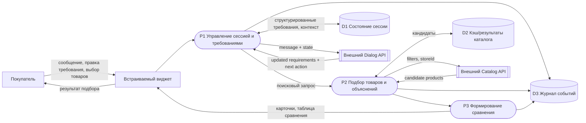
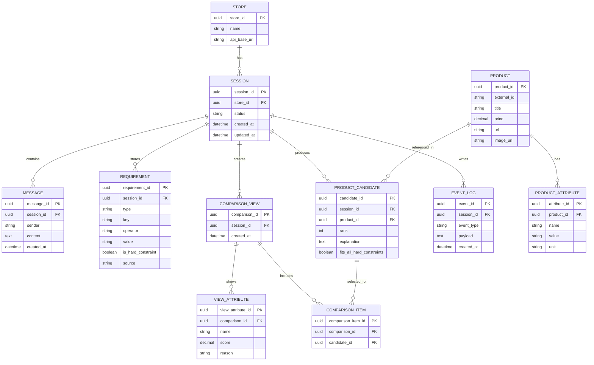
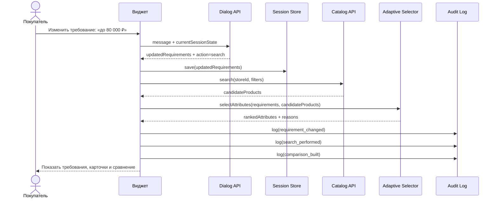
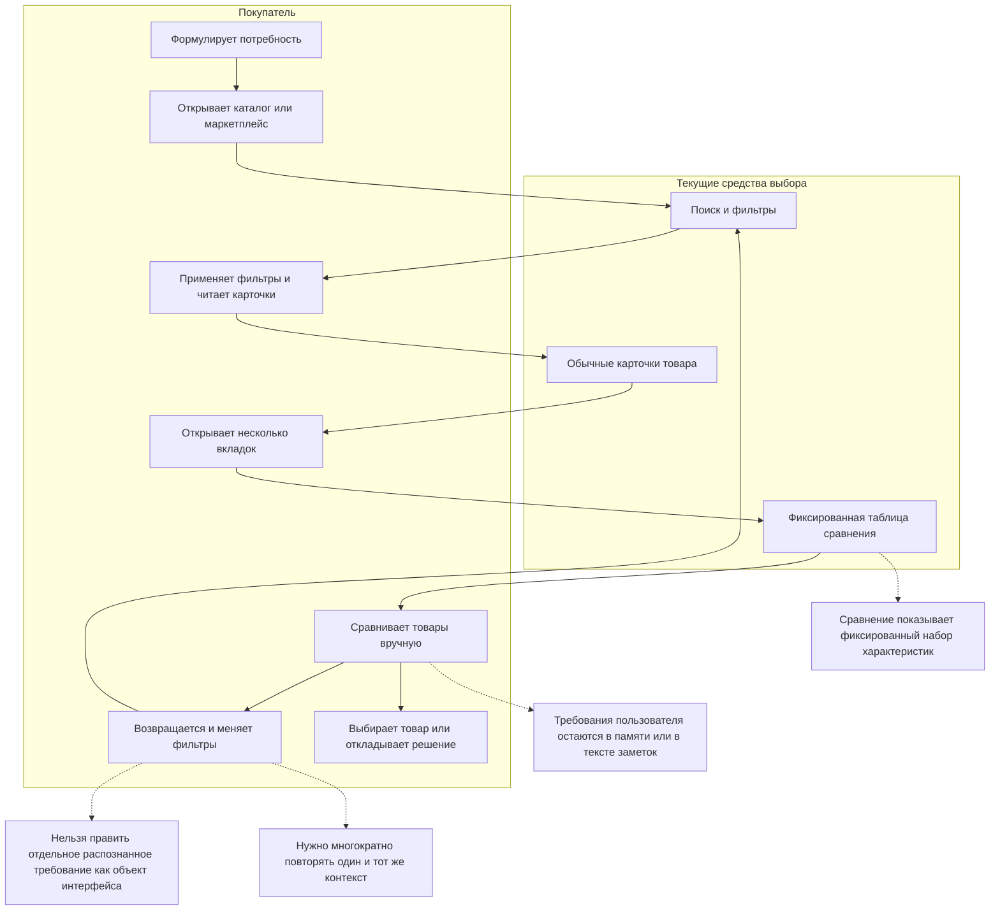
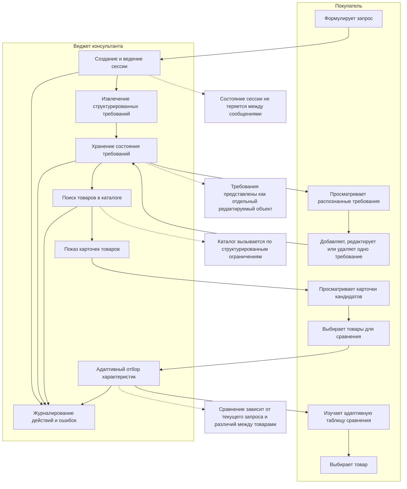

# ЛР 3 — проектирование

**Тема ВКР:** Разработка адаптивного диалогово-визуального интерфейса интеллектуальной системы подбора товаров

**Автор или участники команды:** Березина Софья Константиновна

**Вклад каждого участника при командной работе:** индивидуальная работа; анализ требований, выбор нотаций и построение моделей выполнены автором.

## 1. Предметная область и требования

### Описание предметной области

Разрабатываемая система представляет собой встраиваемый виджет интеллектуального онлайн-консультанта для интернет-магазина. Его задача — помогать покупателю выбрать товар в диалоге, не теряя существенные ограничения и не сводя весь процесс к «чёрному ящику» текстового чата.

Система должна поддерживать сценарий, в котором пользователь формулирует потребность в естественном языке, система извлекает требования к товару, показывает их в явном виде, позволяет редактировать каждое требование отдельно, запрашивает товары из каталога магазина, формирует карточки кандидатов и строит сравнение нескольких товаров по характеристикам, наиболее важным для текущего запроса.

Основные участники предметной области:

- **покупатель** — формулирует запрос, уточняет требования, просматривает карточки и сравнение, выбирает товар;
- **виджет консультанта** — управляет диалогом, хранит состояние сессии, показывает требования и результаты;
- **диалоговый сервис** — извлекает и обновляет структурированные требования, предлагает следующее действие;
- **каталожный сервис магазина** — возвращает товары по структурированным ограничениям;
- **подсистема журналирования и аналитики** — сохраняет действия, ошибки и результаты подбора.

Проектирование опирается на ранее сформулированную цель ВКР: исследовать, улучшает ли качество выбора товаров интерфейс, который сочетает диалог, явное состояние требований и адаптивный отбор характеристик для сравнения.

### Функциональные требования

| ID | Требование | Как проверить выполнение |
|---|---|---|
| FR-01 | Система должна принимать пользовательский запрос на естественном языке и запускать сессию подбора товара для выбранного магазина. | Отправить первый запрос в виджет и убедиться, что создаётся новая сессия с `storeId` и `sessionId`. |
| FR-02 | Система должна извлекать из диалога структурированные требования к товару: категорию, бюджет, обязательные ограничения, предпочтительные характеристики. | Передать тестовые запросы и проверить, что в ответе появляется структурированный список требований. |
| FR-03 | Система должна отображать распознанные требования в явном виде и позволять пользователю добавлять, редактировать и удалять отдельное требование без переписывания всего сообщения. | В интерфейсе изменить одно требование и проверить, что обновляется только соответствующий элемент состояния. |
| FR-04 | Система должна выполнять поиск товаров по структурированным требованиям через внешний каталог магазина. | Передать набор требований и проверить, что вызывается поиск каталога и возвращается список кандидатов. |
| FR-05 | Система должна показывать найденные товары в виде карточек с ключевой информацией: название, цена, основные характеристики, изображение, ссылка. | Для тестового ответа каталога убедиться, что в UI строятся карточки всех кандидатов. |
| FR-06 | Система должна позволять выбрать несколько товаров и формировать их сравнение в одной таблице. | Выбрать 2–3 товара и проверить, что строится единая таблица сравнения. |
| FR-07 | Система должна адаптивно выбирать характеристики для сравнения на основе текущего запроса и различий между товарами. | На одинаковом наборе товаров сравнить результаты для разных запросов и убедиться, что состав характеристик меняется. |
| FR-08 | Система должна сохранять структурированное состояние сессии между сообщениями пользователя. | Отправить несколько последовательных сообщений и проверить, что ранее извлечённые требования остаются доступны и обновляются. |
| FR-09 | Система должна журналировать ключевые действия: изменение требований, запуск поиска, показ рекомендаций, построение сравнения, выбор товара и ошибки интеграции. | Выполнить сценарий подбора и проверить наличие соответствующих записей в журнале событий. |

### Нефункциональные требования

| ID | Требование | Как проверить выполнение |
|---|---|---|
| NFR-01 | Время отклика на обновление рекомендаций после изменения требований не должно превышать 3 секунд при работе с каталогом сценарного масштаба. | Замерить время от подтверждения изменения требования до отображения обновлённых карточек и сравнения. |
| NFR-02 | Система должна обеспечивать изоляцию данных по магазину и сессии: данные одной сессии не должны быть доступны другой. | Проверить, что запросы и состояние адресуются по `storeId` и `sessionId`, а чтение чужой сессии невозможно. |
| NFR-03 | Все существенные действия и ошибки должны быть доступны для аудита и последующего анализа эксперимента. | Проверить наличие структуры журнала с временной меткой, типом события и идентификатором сессии. |
| NFR-04 | При временной недоступности смежного API система не должна терять текущее состояние требований и должна возвращать пользователю контролируемый сценарий восстановления. | Имитировать ошибку внешнего API и проверить сохранение состояния, сообщение об ошибке и возможность повторного запроса. |
| NFR-05 | Архитектура должна допускать подключение виджета к различным магазинам без изменения внутренней логики UI. | Проверить, что интеграция выполняется через внешние API и параметр `storeId`, без привязки компонентов UI к конкретному каталогу. |

## 2. Обзор нотаций и видов диаграмм

| Нотация или вид диаграммы | Что описывает | Сильные стороны |
|---|---|---|
| BPMN | Бизнес-процессы, роли, события, ветвления, последовательность работ | Наглядно показывает текущий и целевой процесс, хорошо подходит для AS-IS / TO-BE и анализа перехода между состояниями |
| IDEF0 | Функции системы, входы, выходы, механизмы и управляющие воздействия | Удобна для функциональной декомпозиции и определения границ системы |
| IDEF3 | Сценарии выполнения процессов и причинно-временные связи | Полезна, когда важно описать варианты протекания процесса и последовательность операций |
| ER-модель (ER-диаграмма) | Сущности предметной области, их атрибуты и связи | Хорошо отражает структуру данных, основу БД и ограничения целостности |
| DFD | Потоки данных между внешними сущностями, процессами и хранилищами | Позволяет увидеть, какие данные откуда приходят, где преобразуются и где сохраняются |
| UML use case | Акторов и пользовательские возможности системы | Удобна для проверки полноты функциональных требований с точки зрения ролей и сценариев использования |
| UML class | Статическую структуру объектов, классов и отношений между ними | Помогает спроектировать доменную модель и программную структуру |
| UML sequence | Взаимодействие объектов и сервисов во времени | Подходит для проверки контрактов API, порядка вызовов и точек отказа |
| UML activity | Логику выполнения сценариев и ветвления в поведении системы | Удобна для детального описания алгоритмов и сложных пользовательских потоков |
| UML component | Компоненты системы и интерфейсы между ними | Помогает обосновать архитектурные решения, интеграции и границы ответственности |
| C4-модель | Архитектуру на уровнях контекста, контейнеров, компонентов и кода | Хорошо подходит для объяснения архитектуры сложных систем разным аудиториям |
| EPC | Бизнес-процессы через события и функции | Полезна для согласования процессов с организационной логикой предприятия |
| DMN | Правила принятия решений и таблицы решений | Подходит, когда нужно формализовать выбор, классификацию или маршрутизацию по правилам |
| ArchiMate | Связь бизнес-слоя, приложений и технологической архитектуры | Удобна для комплексного enterprise-представления ИС на нескольких уровнях |

## 3. Выбор нотаций для проекта

| Нотация или вид диаграммы | Что моделируем | Связанные требования | Почему подходит |
|---|---|---|---|
| BPMN | Пользовательский процесс подбора товара до и после внедрения системы | FR-01, FR-02, FR-03, FR-04, FR-05, FR-06, FR-07, NFR-04 | Лучше всего показывает бизнес-логику и позволяет на одной схеме сравнить AS-IS и TO-BE: где сейчас требования теряются, а где в целевом процессе фиксируются и контролируются. |
| ER-модель | Структуру данных сессии, требований, сообщений, рекомендаций, сравнений и журнала событий | FR-02, FR-03, FR-06, FR-08, FR-09, NFR-02, NFR-03 | Позволяет проверить, что у системы есть формальная модель данных для хранения состояния диалога, результатов подбора и аудита. |
| DFD | Потоки данных между виджетом, диалоговым сервисом, каталогом, хранилищем состояния и журналом | FR-04, FR-05, FR-08, FR-09, NFR-02, NFR-03, NFR-05 | Хорошо показывает взаимодействие компонентов и потоки данных: что приходит от пользователя, что уходит во внешние API и какие данные сохраняются. |
| UML sequence | Детальный сценарий обработки сообщения и построения сравнения | FR-02, FR-03, FR-04, FR-06, FR-07, FR-08, NFR-01, NFR-04 | Подходит для проверки порядка вызовов, зависимостей между сервисами и поведения при обновлении требований. |

Выбор покрывает все три группы задач из условия:

- **бизнес-логика** — BPMN;
- **структура данных и модель БД** — ER-модель;
- **взаимодействие компонентов и потоков данных** — DFD и UML sequence.

Кроме того, именно такая комбинация позволяет связать модели с требованиями: BPMN проверяет пользовательский путь, ER — наличие устойчивого структурированного состояния и аудита, DFD — корректность интеграции, а UML sequence — выполнимость сценария во времени.

## 4. Модели системы

### DFD уровня 1

**Диаграмма:**

**Пояснение модели:** DFD показывает, что виджет не работает изолированно: он получает действия пользователя, управляет состоянием сессии, взаимодействует с двумя внешними API и сохраняет результат в хранилищах состояния, кандидатов и журнала. Поток данных разделён на три процесса: управление диалогом, подбор товаров и построение сравнения.

**Отражённые функциональные требования и элементы модели:**

- FR-01 и FR-02 отражены в процессе **P1**, который создаёт сессию и преобразует сообщение пользователя в структурированные требования.
- FR-03 отражён в потоке «правка требования» от пользователя в виджет и далее в **P1**.
- FR-04 и FR-05 отражены в процессе **P2**, который вызывает каталог и получает карточки кандидатов.
- FR-06 и FR-07 отражены в процессе **P3**, который строит сравнение на основе товаров и актуальных требований.
- FR-08 отражён в хранилище **D1 Состояние сессии**.
- FR-09 отражён в хранилище **D3 Журнал событий**.

**Нефункциональные требования и проектные решения:**

- NFR-02 поддержан явным хранением состояния по сессии и магазину в **D1**.
- NFR-03 поддержан выделенным журналом **D3**.
- NFR-05 поддержан тем, что виджет взаимодействует с внешними сервисами только через API, а не напрямую с конкретной БД магазина.

### ER-модель данных

**Диаграмма:**

**Пояснение модели:** ER-модель фиксирует, что ключевым объектом системы является не отдельное сообщение, а **сессия**, в которой накапливаются сообщения, структурированные требования, кандидаты, построенные сравнения и события аудита. Такая структура поддерживает идею ВКР: требования должны быть не только в тексте чата, но и в формализованном виде.

**Отражённые функциональные требования и элементы модели:**

- FR-02 поддерживается сущностью **REQUIREMENT**.
- FR-03 поддерживается тем, что каждое требование хранится как отдельная запись и может быть изменено независимо.
- FR-06 поддерживается сущностями **COMPARISON_VIEW** и **COMPARISON_ITEM**.
- FR-07 поддерживается сущностью **VIEW_ATTRIBUTE**, где хранится список выбранных характеристик и их вклад.
- FR-08 поддерживается центральной сущностью **SESSION**.
- FR-09 поддерживается сущностью **EVENT_LOG**.

**Нефункциональные требования и проектные решения:**

- NFR-02 обеспечивается связкой `STORE -> SESSION`: состояние изолировано в рамках магазина и сессии.
- NFR-03 обеспечивается отдельной таблицей **EVENT_LOG**.
- Для NFR-04 состояние и требования не теряются при повторном запросе, так как живут независимо от конкретного ответа внешнего сервиса.

### UML sequence — сценарий «уточнение требований и построение сравнения»

**Диаграмма:**

**Пояснение модели:** диаграмма последовательностей показывает порядок взаимодействия компонентов в одном из ключевых сценариев: пользователь уточняет одно требование, после чего система не теряет остальной контекст, а пересчитывает выдачу и сравнение.

**Отражённые функциональные требования и элементы модели:**

- FR-03 отражён в первом сообщении пользователя о правке требования.
- FR-02 отражён в ответе **Dialog API**, который возвращает обновлённые структурированные требования.
- FR-04 отражён вызовом `search(storeId, filters)` к **Catalog API**.
- FR-06 отражён итоговым действием «Показать ... сравнение».
- FR-07 отражён компонентом **Adaptive Selector**, который вычисляет набор характеристик для таблицы.
- FR-08 отражён передачей `currentSessionState` и сохранением через **Session Store**.

**Нефункциональные требования и проектные решения:**

- NFR-01 проверяется на уровне длины цепочки вызовов и минимизации лишних шагов в сценарии.
- NFR-04 поддерживается тем, что состояние сохраняется отдельно от каталожного ответа; это позволяет повторять вызовы без потери контекста.
- NFR-03 отражён явными вызовами журналирования.

## 5. AS-IS и TO-BE

**Выбранная нотация:** BPMN (в отчёте представлена в виде BPMN-подобных диаграмм Mermaid с дорожками ролей)

### AS-IS — текущее состояние

**Диаграмма:**

**Описание и ограничения:**

В текущем процессе покупатель работает либо с обычными фильтрами каталога, либо с диалоговым интерфейсом без явного визуального состояния требований. В результате:

- ограничения пользователя хранятся «в голове» или в истории текста;
- изменение одного критерия требует повторного ввода части контекста;
- сравнение товаров обычно строится по фиксированному набору характеристик;
- трудно понять, какие ограничения уже учтены системой, а какие потеряны.

Это состояние плохо поддерживает FR-02, FR-03 и FR-07 и создаёт риск ошибок выбора.

### TO-BE — предлагаемое состояние

**Диаграмма:**

**Описание изменений:**

В целевом процессе встраиваемый виджет становится явным посредником между диалогом и каталогом. Ключевые изменения по сравнению с AS-IS:

- требования превращаются в **структурированное и видимое состояние**;
- пользователь может менять **одно требование**, не переписывая весь запрос;
- поиск и сравнение строятся не по произвольному тексту, а по формализованному набору ограничений;
- набор характеристик для таблицы сравнения зависит от конкретного сценария выбора;
- действия и ошибки журналируются для анализа эксперимента.

### Обоснование перехода

Переход от AS-IS к TO-BE обеспечивается следующими проектными решениями:

1. **Введение структурированного состояния требований** (`REQUIREMENT`, `SESSION`) закрывает проблему AS-IS, где требования хранятся только в тексте или в памяти пользователя. На TO-BE это видно в узлах **V2** и **V3**. Это обеспечивает FR-02, FR-03 и FR-08.
2. **Разделение процессов извлечения требований и поиска товаров** позволяет сначала понять запрос пользователя, а затем вызывать каталог уже по формализованным фильтрам. На TO-BE это узлы **V2 -> V3 -> V4**. Это обеспечивает FR-04 и NFR-05.
3. **Адаптивный отбор характеристик** заменяет фиксированное сравнение AS-IS. На схеме это узел **V6**, соответствующий FR-07.
4. **Журналирование** вводится как обязательный архитектурный элемент, а не побочный эффект. На TO-BE это узел **V7**, обеспечивающий FR-09 и NFR-03.
5. **Устойчивость к отказам внешних API** достигается за счёт того, что состояние сессии хранится отдельно от ответа каталогов и LLM-сервиса. Это следует из сочетания узлов **V1**, **V3** и модели данных раздела 4; таким образом поддерживается NFR-04.

По сравнению с AS-IS улучшения достигаются в трёх ключевых точках:

- уменьшается когнитивная нагрузка на пользователя, потому что требования показаны явно;
- уменьшается число повторных шагов, потому что можно редактировать отдельный критерий;
- повышается объяснимость выбора, потому что таблица сравнения строится по характеристикам, релевантным текущему запросу.

## 6. Выводы

Для данной темы ВКР выбранные нотации соответствуют предметной области, потому что вместе покрывают процесс, данные и взаимодействия.

- **BPMN** подходит для показа пользовательского пути и особенно полезна для сравнения AS-IS и TO-BE.
- **ER-модель** подходит для проверки того, что у системы действительно есть формализованное состояние требований, сравнения и аудита, а не только текстовый чат.
- **DFD** показывает, как данные проходят через виджет, внешние API и внутренние хранилища.
- **UML sequence** подтверждает, что ключевой сценарий изменения требований и перестроения сравнения выполним на уровне взаимодействия компонентов.

Представленные модели подтверждают выполнение ключевых требований следующим образом:

- функциональные требования FR-02, FR-03, FR-06, FR-07 и FR-08 отражены сразу в нескольких моделях, а значит являются не декларативными, а поддержаны проектно;
- нефункциональные требования NFR-02, NFR-03, NFR-04 и NFR-05 учтены в архитектуре потоков данных, структуре БД и механизмах журналирования;
- улучшение в TO-BE по сравнению с AS-IS наглядно видно в появлении явного состояния требований, отдельного процесса адаптивного сравнения и устойчивого хранения сессии.

Этап проектирования показал согласованность процессов, данных и взаимодействий:

- процессная модель объясняет, **зачем** выполняются действия;
- ER-модель фиксирует, **что** именно хранится;
- DFD и UML sequence показывают, **как** данные и вызовы проходят между компонентами.

Итог проектирования: предложенная система может быть реализована как универсальный виджет консультанта для магазина, в котором пользовательский диалог, состояние требований, подбор товаров и сравнение сведены в единую согласованную модель. Это создаёт основу для следующего этапа ВКР — реализации и экспериментальной проверки влияния интерфейса на качество выбора товара.
